<div align="center">



<br />

[](#-技能列表)
[](#-核心技能oss-quick-brief)
[](#-极速安装)
[](https://github.com/Snow7-G/4Qi-skill)

<p align="center">
  <b>告别“点开 GitHub 一脸懵”——用计算机学生听得懂的大白话，3 分钟看懂任意开源项目。</b>
</p>

<p align="center">
  <a href="#-为什么做这个项目">痛点对比</a> ·
  <a href="#-动态效果演示">动态演示</a> ·
  <a href="#-核心技能oss-quick-brief">设计亮点</a> ·
  <a href="#-极速安装">极速安装</a> ·
  <a href="#-使用方式">使用方式</a> ·
  <a href="#-仓库结构">仓库结构</a>
</p>

</div>

---

## 🎯 为什么做这个项目？

很多计算机专业同学在 GitHub 刷到热榜项目、看到老师/学长推荐的工具时，点进去往往会被满屏的英文营销词（*blazing fast、cloud-native、enterprise-grade*）、密密麻麻的配置文件和冗长文档劝退——**其实我们一开始并不想啃万行源码，只是想快速搞懂：这东西到底干嘛的、为什么会有它、怎么用。**

| 对比维度 | 传统方式 / 直接问普通 AI | 使用 `4Qi-skill`（`oss-quick-brief`） |
| :--- | :--- | :--- |
| **阅读门槛** | 满屏翻译腔 README、营销词与黑话 | **强制大白话 + 生活/编程类比**，术语首次出现括号 ≤10 字解释 |
| **信息密度** | 动辄甩出几千字长文或整个目录树 | **严格控制在 600~1000 字（3 分钟读完）**，绝不主动深挖源码 |
| **上手体验** | 照搬几百行复杂配置，跑一半才发现要收费或缺环境 | **按项目类型定制 ≤15 行最小示例**，提前给出 **避坑与成本提醒** |
| **学习决策** | 看完依然不知道和自己有什么关系 | 顶部 **5 秒速查标签** + 底部 **学习小贴士**，看完立刻知道值不值得学 |

---

## ✨ 动态效果演示

<div align="center">
  
</div>

<details>
<summary><b>👀 点击展开：真实输出效果样张（以 <code>uv</code> 为例）</b></summary>

> **速查标签**：`Python 开发工具 / CLI` · `Rust 编写` · 上手难度 `★☆☆`  
> **一句话定位**：把 pip、venv、pyenv 合二为一的极速 Python 环境管理工具。
>
> **1. 它是干嘛的？（What）**  
> 以前写 Python 就像装修要自己分别找水电工（装库）、木工（建虚拟环境）和包工头（切 Python 版本）；`uv` 相当于直接请了一家全包施工队，一条命令全搞定，而且速度快到像开了倍速。
>
> **2. 为什么会有它？（Why）**  
> 解决 `pip` 装包慢、版本冲突、环境工具杂的痛点；用 Rust 重写并支持全局缓存复用，装包通常比 `pip` 快 10~100 倍。
>
> **3. 怎么用？（How）**
> ```bash
> curl -LsSf https://astral.sh/uv/install.sh | sh
> uv init my-demo && cd my-demo
> uv add requests
> uv run main.py
> ```
> - **避坑与成本提醒**：完全免费纯本地运行；装完后若终端提示找不到 `uv`，重启终端即可生效。
>
> **4. 给学生的学习小贴士**  
> 前置知识：会基础 Python 即可 · 建议动作：非常值得花 10 分钟装上替代 pip。

</details>

---

## 🧩 技能列表

| 技能名称 | 版本 | 适用场景 | 状态 |
| :--- | :---: | :--- | :---: |
| [`oss-quick-brief`](./oss-quick-brief/SKILL.md) | `v0.3` | 面向计算机学生的开源项目 3 分钟速览官（What / Why / How） | ✅ 可用 |

---

## 💡 核心技能：`oss-quick-brief`

围绕**“低认知负荷 + 防幻觉 + 学生视角”**打磨的四重保障：

1. **5 秒速查卡片**：顶部直接标出 `领域/类型 · 技术栈 · 难度` + `≤25 字一句话定位`，先建立全局坐标再看细节。
2. **4 类项目自适应「怎么用」**：自动识别 **CLI 工具 / 开发框架 / 自托管平台 / 论文算法仓库**，拒绝千篇一律硬塞代码。
3. **体验红线 + 生成前 4 项自检**：严禁翻译腔营销词、严禁生僻术语裸奔、严禁脑补未查证命令、严禁在未追问时展开源码目录。
4. **一击直出，按需追问**：不先弹繁琐问卷，直接给完整速览卡，文末附 3 个轻量追问引导（通俗原理 / 5 分钟 Demo / 同类选型）。

---

## 🚀 极速安装（终端一键配置）

复制对应 Agent 的**单行命令**到终端回车即可自动拉取并安装完成（自动清理临时目录）：

#### 1. Antigravity
```bash
git clone --depth 1 https://github.com/Snow7-G/4Qi-skill.git /tmp/4Qi-skill && mkdir -p ~/.gemini/config/skills && cp -r /tmp/4Qi-skill/oss-quick-brief ~/.gemini/config/skills/ && rm -rf /tmp/4Qi-skill
```

#### 2. Codex（OpenAI Codex CLI）
```bash
git clone --depth 1 https://github.com/Snow7-G/4Qi-skill.git /tmp/4Qi-skill && mkdir -p ~/.codex/skills && cp -r /tmp/4Qi-skill/oss-quick-brief ~/.codex/skills/ && rm -rf /tmp/4Qi-skill
```

#### 3. Pi（pi-coding-agent）
```bash
git clone --depth 1 https://github.com/Snow7-G/4Qi-skill.git /tmp/4Qi-skill && mkdir -p ~/.pi/agent/skills && cp -r /tmp/4Qi-skill/oss-quick-brief ~/.pi/agent/skills/ && rm -rf /tmp/4Qi-skill
```

#### 4. WorkBuddy
```bash
git clone --depth 1 https://github.com/Snow7-G/4Qi-skill.git /tmp/4Qi-skill && mkdir -p ~/.workbuddy/skills && cp -r /tmp/4Qi-skill/oss-quick-brief ~/.workbuddy/skills/ && rm -rf /tmp/4Qi-skill
```

<details>
<summary><b>⚡ 进阶：一条命令同时配置全部 4 个 Agent（或仅配置到当前项目）</b></summary>

**同时安装到 Antigravity + Codex + Pi + WorkBuddy：**
```bash
git clone --depth 1 https://github.com/Snow7-G/4Qi-skill.git /tmp/4Qi-skill && for d in ~/.gemini/config/skills ~/.codex/skills ~/.pi/agent/skills ~/.workbuddy/skills; do mkdir -p "$d" && cp -r /tmp/4Qi-skill/oss-quick-brief "$d/"; done && rm -rf /tmp/4Qi-skill
```

**仅在当前仓库项目内启用（通用 `.agents/skills/` 标准）：**
```bash
git clone --depth 1 https://github.com/Snow7-G/4Qi-skill.git /tmp/4Qi-skill && mkdir -p .agents/skills && cp -r /tmp/4Qi-skill/oss-quick-brief .agents/skills/ && rm -rf /tmp/4Qi-skill
```

</details>

> 💡 本仓库遵循标准 `SKILL.md` + `references/` 目录规范，安装路径一览：`Antigravity (~/.gemini/config/skills)` · `Codex (~/.codex/skills)` · `Pi (~/.pi/agent/skills)` · `WorkBuddy (~/.workbuddy/skills)`。

---

## 💬 使用方式

安装完成后，打开新对话，像平时聊天一样直接提问即可自动触发：

- **只给项目名**：`帮我快速了解一下 FastAPI / Ollama / Docker`
- **直接甩 GitHub 链接**：`https://github.com/Tencent/LoopForge 这项目是干嘛的？`
- **本地刚 clone 的陌生仓库**：`介绍一下这个仓库，怎么用，值不值得学？`

---

## 📂 仓库结构

```text
4Qi-skill/
├── README.md                          # 中文项目说明文档
├── assets/
│   ├── hero-banner.svg                # 动态霓虹头图
│   └── demo-workflow.svg              # 工作流动态演示图
└── oss-quick-brief/                   # 开源项目 3 分钟速览官 Skill
    ├── SKILL.md                       # 核心触发词、执行流程与 4 项自检红线
    └── references/
        └── examples.md                # CLI / 框架 / 平台三类范例与反面避坑表
```

---

<div align="center">

如果这个 Skill 帮你省下了啃陌生文档的时间，欢迎点一个 ⭐ **Star** 支持一下！  
也欢迎提 Issue 或 PR，一起把更多适合计算机学生的实用 Agent Skill 加进 `4Qi-skill`。

</div>
