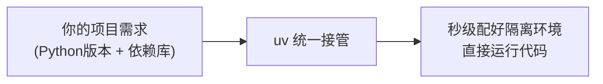
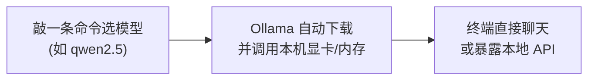

# 输出范例与风格校准（Few-Shot Examples）

以下 3 个范例覆盖最常见的 3 类开源项目（CLI 工具 / 开发框架 / 自托管平台），示范如何做到 **零重复、600~1000 字、术语即用即解、明确成本避坑**。

---

## 范例 1：命令行工具类（`uv`）

# uv：3 分钟速览

> **速查标签**：`Python 开发工具 / CLI` · `Rust 编写` · 上手难度 `★☆☆`  
> **一句话定位**：把 pip、venv、pyenv 合二为一的极速 Python 环境管理工具。

## 1. 它是干嘛的？（What）
- **通俗类比**：以前写 Python 就像装修要自己分别找水电工（装库）、木工（建虚拟环境）和包工头（切 Python 版本）；`uv` 相当于直接请了一家全包施工队，一条命令全搞定，而且速度快到像开了倍速。
- **核心流程**：


## 2. 为什么会有它？（Why）
- **没它之前有多痛**：写 Python 最容易被环境劝退——`pip` 装包慢还常版本冲突；建隔离环境要用 `venv`；切版本又要装 `conda` 或 `pyenv`，命令杂、踩坑多。
- **它的核心破局点**：用 Rust（以运行极快著称的系统语言）重写整套包管理逻辑，并做了全局缓存复用，装包通常比 `pip` 快 10~100 倍，一套命令管到底。
- **和常见工具的区别**：
  | 对比项 | uv | pip + venv | Conda |
  | :--- | :--- | :--- | :--- |
  | 核心定位 | 新一代一站式极速 Python 工具 | Python 官方默认基础组合 | 偏科研/数据科学的重型环境管理器 |
  | 适合什么时候用 | 几乎所有现代 Python 开发，省心又快 | 只需临时装一两个简单库 | 需要管理非 Python 底层库（如 CUDA）时 |

## 3. 怎么用？（How）
**最小可感知体验**：
```bash
# 1. 安装 uv（macOS / Linux）
curl -LsSf https://astral.sh/uv/install.sh | sh

# 2. 初始化一个新项目（自动生成配置文件）
uv init my-demo && cd my-demo

# 3. 装第三方库（自动建虚拟环境 + 锁版本，无需手动 activate）
uv add requests

# 4. 直接在项目环境里跑脚本
uv run main.py
```
- **避坑与成本提醒**：完全免费纯本地运行；装完后若终端提示找不到 `uv`，重启终端即可生效。
- **学生常见使用场景**：
  1. 复现 GitHub 上的 Python/AI 项目时，用 `uv` 装依赖，少踩 80% 的环境报错坑。
  2. 写课设或组队开发时，靠锁文件把依赖版本锁死，发给队友一键跑通。

## 4. 给学生的学习小贴士
- **前置知识**：写过基础 Python、用过 `pip install` 就能无痛上手。
- **建议动作**：**非常值得现在花 10 分钟装上替代 pip**，日常写作业和做项目立竿见影提效。

---
想继续了解可以接着问我：
1. 用更通俗的例子再讲一遍“虚拟环境”和“锁文件”是干嘛的
2. 怎么把现有的 `requirements.txt` 项目迁移到 `uv`？
3. 跑深度学习项目时它和 `conda` 怎么选？

---

## 范例 2：开发框架类（`FastAPI`）

# FastAPI：3 分钟速览

> **速查标签**：`Python 后端 Web 框架` · `Python` · 上手难度 `★☆☆`  
> **一句话定位**：用普通 Python 函数快速写出后端 API 并自动生成测试文档的框架。

## 1. 它是干嘛的？（What）
- **通俗类比**：做前后端分离项目时，前端网页像“餐厅点菜的顾客”，后端像“后厨”。`FastAPI` 帮你把平时写的普通 Python 函数包装成“标准化出菜窗口（API 接口）”，还顺手把带试吃按钮的“菜单（交互式接口文档）”自动印好。
- **核心流程**：
  - **输入**：带参数类型标注（如 `age: int`）的普通 Python 函数。
  - **处理**：自动接管网络请求、校验前端传来的数据格式、把结果转成 JSON（通用数据交换格式）。
  - **输出**：可直接访问的后端服务 + 自带测试按钮的在线文档页面。

## 2. 为什么会有它？（Why）
- **没它之前有多痛**：用传统框架写接口，要手写一大堆参数检查代码（判断是不是数字、有没有漏传字段），写完还得另写一份接口文档给前端队友，代码一改文档就过期。
- **它的核心破局点**：巧用 Python 自带的“类型提示”，写一次类型标注，同时搞定**数据校验 + 报错提示 + 自动生成文档**三件事，还原生支持异步（同时处理大量请求不卡顿）。
- **和常见工具的区别**：
  | 对比项 | FastAPI | Flask | Django |
  | :--- | :--- | :--- | :--- |
  | 核心定位 | 现代、轻量的纯 API 接口框架 | 极简微框架，什么都自己拼 | “全家桶”重型框架，自带后台和数据库工具 |
  | 适合什么时候用 | 前后端分离项目、给 AI 模型套接口 | 极小型练手项目 | 需要完整管理后台的传统大型网站 |

## 3. 怎么用？（How）
**最小可感知体验**：
```bash
# 1. 安装 FastAPI 及运行工具
pip install "fastapi[standard]"
```
```python
# 2. 新建 main.py，写一个最简单的接口
from fastapi import FastAPI

app = FastAPI()  # 创建一个后端应用

@app.get("/hello/{name}")  # 定义访问路径
def say_hello(name: str, age: int = 18):  # 自动校验 age 必须是整数
    return {"message": f"你好 {name}，你今年 {age} 岁"}
```
```bash
# 3. 启动服务，浏览器打开 http://127.0.0.1:8000/docs 直接点按钮测接口
fastapi dev main.py
```
- **避坑与成本提醒**：免费纯本地运行；安装时务必给 `"fastapi[standard]"` 加双引号，防止终端误解析中括号。
- **学生常见使用场景**：
  1. 毕设/课设做前后端分离（Vue/React 前端 + Python 后端）。
  2. 把自己训练的模型或大模型脚本包装成网页接口给别人调用。

## 4. 给学生的学习小贴士
- **前置知识**：会 Python 函数、字典和基础 HTTP 概念（GET/POST 请求）。
- **建议动作**：**如果你会 Python 且近期要做课设/毕设，强烈建议直接用它上手**。

---
想继续了解可以接着问我：
1. 帮我解释一下上面代码里的 `@app.get`（装饰器）和异步 `async` 是什么意思
2. 带我 5 分钟在本地跑通这个 Demo 并加一个 POST 接口
3. 做毕设时它和 Spring Boot / Flask 怎么选？

---

## 范例 3：自托管平台类（`Ollama`）

# Ollama：3 分钟速览

> **速查标签**：`本地大模型运行平台` · `Go / C++` · 上手难度 `★☆☆`  
> **一句话定位**：一条命令在你自己电脑上离线下载并运行开源大模型的工具。

## 1. 它是干嘛的？（What）
- **通俗类比**：以前在自己电脑跑开源大模型像“买散件自己组装电脑”，`Ollama` 则是给大模型做了一个“应用商店 + 一键启动器”——选好模型名字敲一行命令，它帮你下好、配好显卡、直接开聊。
- **核心流程**：


## 2. 为什么会有它？（Why）
- **没它之前有多痛**：以前本地跑开源模型，要先装 Python、PyTorch、CUDA（显卡计算驱动）、下几十 GB 权重文件再写推理脚本，光配环境就能折腾一整天。
- **它的核心破局点**：把模型权重、配置和推理引擎打包成单一镜像，自动适配你的显卡或 Apple Silicon 芯片，同时对外提供兼容 OpenAI 格式的本地接口，其他软件拿来就能连。
- **和常见工具的区别**：
  | 对比项 | Ollama | ChatGPT / DeepSeek 网页版 | Hugging Face Transformers |
  | :--- | :--- | :--- | :--- |
  | 核心定位 | 傻瓜式本地运行大模型工具 | 官方云端在线聊天服务 | 面向科研/开发的底层模型代码库 |
  | 适合什么时候用 | 断网离线用、保护隐私、免费练手调 API | 追求最强模型效果、不想占本机内存 | 需要微调模型、改网络结构做实验 |

## 3. 怎么用？（How）
**最小可感知体验**：
```bash
# 1. 去官网下载安装包（macOS/Windows/Linux 均有图形安装器）

# 2. 在终端运行一条命令：自动下载并进入对话（以轻量模型为例）
ollama run qwen2.5:3b

# 3. 启动后它也在本地 11434 端口提供接口，可直接用代码调用
```
- **避坑与成本提醒**：软件和调用完全免费，但非常吃本机内存/显存——普通 16GB 内存笔记本优先选 `3b` 或 `7b/8b` 模型，别直接跑 `32b` 以上的大尺寸。
- **学生常见使用场景**：
  1. 做 AI 课设/毕设想调大模型 API，但不想花钱买官方 Token 额度时，用它当免费本地后端。
  2. 写代码/读论文时想完全离线使用 AI，保护隐私数据。

## 4. 给学生的学习小贴士
- **前置知识**：会打开终端敲一行命令就行，零 AI 基础也能玩。
- **建议动作**：**非常值得花 10 分钟装来体验一次“在自己电脑离线跑大模型”的感觉**。

---
想继续了解可以接着问我：
1. 模型的 `3b / 7b / 量化(Q4)` 这些后缀到底是什么意思？
2. 教我怎么用 5 行 Python 代码调用本地跑起来的 Ollama 接口
3. 它和 LM Studio（带图形界面的本地模型工具）怎么选？

---

## 反面教材避坑（编写时必须避免）

| 常见烂写法（禁止） | 正确写法（推荐） |
| :--- | :--- |
| 顶部说“极速 Python 工具”，紧接着第 1 节又写“它是一个极速 Python 工具”。 | 顶部用 ≤25 字精准定性，第 1 节换一个生活/编程场景打比方，零重复。 |
| “FastAPI 是一个现代、高性能、生产级的异步 Web 框架，基于 Starlette 和 Pydantic 构建。” | “把普通 Python 函数包装成后端接口，并自动生成可点击测试的接口文档。” |
| 没查到安装命令时，自己瞎猜一个 `pip install xxx` 或 `npm i -g xxx`。 | 宁可写清晰步骤概要并标注“具体命令以官方 README 为准”，绝不编造。 |
| 默认学生懂 `ASGI`、`ORM`、`沙箱`、`CI/CD`。 | 尽量不用；必须出现时加括号翻译，如 `ORM（用代码操作数据库的工具）`。 |
